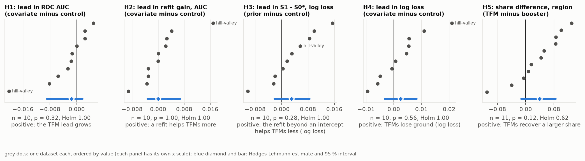
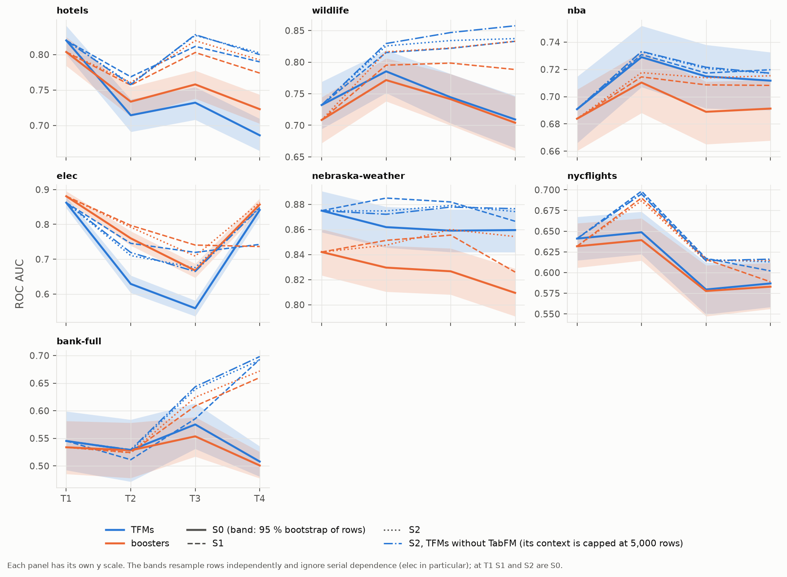

# tfm-drift

Do tabular foundation models keep their lead over tuned gradient boosters when the test data drifts? The pre-registered design is in [plan.md](plan.md).

Datasets, the loader and the model wrappers come from [SmallDataBenchmarks](https://github.com/firefly1248/SmallDataBenchmarks), read in place: clone it next to this folder or set `SDB_ROOT`.

Setup:

1. Clone SDB next to this folder, or set `SDB_ROOT`. Any SDB commit works whose `benchmark/` and `config.py` match d8c2e7b; `sdb.assert_pinned` checks this (checked at f2d89f2).
2. `uv sync`
3. Study A only: build SDB's prepared files with SDB's `scripts/es_time_prep.py`, following SDB's `results/es_time/DATA_SOURCES.md`. himalaya and f1-dnf need their own access terms. Without this step Study B, the tests and the analysis from the release archive (step 5) still run, and the gate prints that Study A is skipped.
4. Gate and tests: `uv run python -m scripts.drift_windows`, then `uv run pytest`.
5. Get the run checkpoints, either from the release or by running the queue (609 runs, about 21 machine hours).
   - Release: download `drift_runs.tar.xz` from [checkpoints-2026-11-21](https://github.com/firefly1248/tfm-drift/releases/tag/checkpoints-2026-11-21) and extract it at the repository root with `tar -xJf drift_runs.tar.xz`. It holds the 567 checkpoints that are analyzed (himalaya and f1-dnf are not in it); `results/runs_manifest.json` lists the sha256 of every file. The TabPFN and TabFM predictions in it fall under their weights' non-commercial licenses (see Licenses).
   - Queue: `mkdir -p logs`, then `uv run python -m scripts.drift_queue > logs/queue.log 2>&1`. Add `--skip-study-a` if step 3 was skipped.
6. Analysis (about 1.5 minutes) and figures: `uv run python -m scripts.drift_analysis --checks-reviewed` writes `results/drift_*.csv`, and `uv run python -m scripts.drift_figures` writes `results/figures/*.png`. Without `--checks-reviewed` the analysis stops after the checks.

The gate's counts reproduce exactly across platforms, while `mean_z` and `mean_z2` can differ by about 1e-5 (PCA numerics).

## Findings

### In short

- Under injected drift (Study B, ten datasets) none of the five pre-registered tests is rejected.
- On covariate and prior drift (H1 to H4) the 95 % intervals lie within about 0.009 of zero. That does not rule out a change of about half a typical lead (the median control lead in ROC AUC at T4 is 0.014), so it is no equivalence result.
- Under covariate drift, the refit gain showed no detectable difference between the families (H2: estimate 0.0000, interval -0.0033 to 0.0067).
- Under concept drift the point estimate favors the foundation models (H5: share difference 0.040), but the interval includes zero (-0.013 to 0.085, Holm p 0.62).
- On real time-ordered data (Study A, seven datasets, descriptive, no p-values) the foundation-model lead in ROC AUC at T4 is positive on 5 of 7 datasets for a static model and on 7 of 7 with a sliding refit. A sliding refit raised ROC AUC at T4 on 6 of 7 datasets for both families.

Every window is small (200 to 2,000 rows), the regime where foundation models are strongest, and the drift in Study B is synthetic.

Study B, the five primary tests (exact Wilcoxon on per-dataset values, Hodges-Lehmann estimate with its 95 % interval, Holm over five). No test is rejected.

| test | n | estimate | 95 % interval | p | Holm p | positive means |
|---|---|---|---|---|---|---|
| H1 lead in ROC AUC at T4, covariate minus control | 10 | -0.0016 | -0.0089 to 0.0017 | 0.32 | 1.00 | the TFM lead grows |
| H2 lead in refit gain (S1 - S0), ROC AUC, covariate minus control | 10 | 0.0000 | -0.0033 to 0.0067 | 1.00 | 1.00 | a refit helps TFMs more |
| H3 lead in S1 - S0*, log loss, prior minus control | 10 | 0.0031 | -0.0022 to 0.0084 | 0.28 | 1.00 | the refit beyond an intercept helps TFMs less |
| H4 lead in log loss at T4, covariate minus control | 10 | 0.0024 | -0.0033 to 0.0083 | 0.56 | 1.00 | TFMs lose ground |
| H5 TFM share minus booster share, region, ROC AUC | 11 | 0.040 | -0.013 to 0.085 | 0.12 | 0.62 | TFMs recover a larger share |

Gray dots: one dataset each, ordered by value (each panel has its own x scale). Blue diamond and bar: Hodges-Lehmann estimate and 95 % interval.

- The intervals of H1 to H4 lie within about 0.009 of zero, but single datasets move more: up to 0.02 (hill-valley-with-noise in H1, H2 and H4; qsar-biodegradation 0.015 in H3). The control lead in ROC AUC at T4 is 0.004 to 0.048 on nine datasets (median 0.014; 0.43 on hill-valley-with-noise), so an interval this wide does not exclude a change of about half a typical lead. This is no equivalence result.
- H2 and H3 are contrasts of the refit gain, not leads.
- The tilted block is easier than the control's for the boosters in ROC AUC (CatBoost, LightGBM and XGBoost higher on 9, 9 and 8 of 10 datasets) but not clearly for the TFMs (TabFM, TabPFN-3.5 and TabICLv2 on 5, 6 and 7 of 10). Log loss is lower on 5 of 10 for CatBoost and for each TFM.
- H5 ran on 11 of 12 datasets (hill-valley-with-noise fails the guard, as expected; the oracle gains on the 11 run from 0.24 to 0.64). It is not rejected, so the reading rule of plan 5 is not applied.

Reported next to the tests, with no verdict:

| quantity | n | estimate | 95 % interval | p |
|---|---|---|---|---|
| H3, prior 0.5 alone | 10 | 0.0020 | -0.0056 to 0.0101 | 0.43 |
| H3, prior 2 alone | 10 | 0.0042 | -0.0029 to 0.0112 | 0.38 |
| lead in S1, covariate minus control (equals H1 + H2) | 10 | -0.0029 | -0.0055 to 0.0016 | 0.13 |
| lead in S1, region minus control | 9 | 0.0044 | -0.0918 to 0.0233 | 0.73 |
| log error ratio, covariate minus control | 10 | 0.034 | -0.037 to 0.117 | 0.32 |
| H5 rule 1: lead in S1 - S0 at T4, region | 11 | 0.029 | 0.005 to 0.055 | 0.019 |
| H5 rule 2: share difference outside the band | 11 | 0.027 | 0.003 to 0.054 | 0.014 |

Leaving out bank-marketing-full takes H5 to p = 0.02 (unadjusted, 10 datasets). The control diagnostic (check 6) does not exclude zero for either outcome. The noise and swap arms pass the oracle-gain guard on two datasets each, so their shares are descriptive. Every exploratory table is a `results/drift_*.csv`: per-model scores, the leads by strategy and block (S2 included), the dose slopes, the static model next to the control, calibration slopes, the comparison with the benchmark's random-split lead, and the Study A curves with signs.

Study A (descriptive, no p-values; the intervals resample rows independently and ignore serial dependence, so they are too narrow on autocorrelated streams such as elec): at T4 under S0 the TFM lead in ROC AUC is positive on 5 of 7 datasets, under S1 on 7 of 7. A sliding refit raises ROC AUC at T4 on 6 of 7 datasets for TFMs and for boosters; the 95 % interval of the gain excludes zero on 5 and 6.

Exploratory: `results/drift_study_a_curves_block.csv` holds the Study A curves with a circular moving-block bootstrap of the time-ordered rows (L = 13, the rounded cube root of the block size, and L = 100; the `L` column). The widest ratio of the lead's band in ROC AUC at T4, block over independent rows, over S0, S1 and S2, for L = 13 and L = 100: bank-full 1.15 and 1.38, elec 1.77 and 2.35, hotels 1.08 and 1.30, nba 1.01 and 0.92, nebraska-weather 1.36 and 1.74, nycflights 1.09 and 1.04, wildlife 1.14 and 1.20.

Family means under S0 (band: 95 % bootstrap of rows), S1 and S2 for each Study A dataset; each panel has its own y scale.

More figures:

- [lead_by_block.png](results/figures/lead_by_block.png): the change of the S0 lead in ROC AUC since T1 under every Study B arm, one line per dataset.
- [h5_shares.png](results/figures/h5_shares.png): the share of its own oracle gain that each family recovers in the region arm.
- [study_a_lead.png](results/figures/study_a_lead.png): the Study A lead (TFMs minus boosters) by strategy, with a paired bootstrap band.

Checks. 609 runs were made (588 from the queue in 21.2 h, 21 from the pilot); the 567 that are analyzed (see Study A scope below) are all present, with no missing cell or score and no non-finite probability. Every dataset's label 1 is the minority class of the dataset (single blocks of hill-valley-with-noise exceed 0.5 by sampling); the control prevalence is at most 0.496 and no model's S0 ROC AUC at T1 is below 0.5. Two checks are flagged and read, and none is a fault of the code:

- 82 cells hold a single distinct prediction: logistic regression on bank-full (21 cells in the 3 runs, where the selected penalty, C at most 0.01 with l1_ratio 0.5 or 1.0, zeroes every coefficient) and XGBoost on hill-valley-with-noise (61 cells, seeds 0 and 5, ROC AUC exactly 0.5).
- 19 of 3,290 seed-mean cells and 418 of 15,750 single-seed cells sit within 0.01 of their AP floor, all where the models have no signal: the boosters on hill-valley-with-noise (359 single-seed cells), bank-full of Study A (49; every model's S0 seed-mean ROC AUC is 0.49 to 0.58, while S1 and S2 reach 0.71 at T4), and logistic regression on banana (10).

First-public dates of the Study A datasets (plan 4.1; sources and confidence in `results/study_a_first_public.csv`). All seven were public years before any TFM used here, so Study A cannot separate pretraining exposure from robustness to drift.

| dataset | first public |
|---|---|
| hotels | 2018-11 |
| wildlife | 2009-04-24 for all fields (records from 1990, part public earlier) |
| nba | 2015-05-21 |
| elec | 1999 (technical report; not seen at the source) |
| nebraska-weather | by 2011-10 |
| nycflights | 2014-07-22 |
| bank-full | 2012-02-13 |

## Licenses

- Code: GPL-3.0, see `LICENSE`. This is the license of SmallDataBenchmarks, whose code this project imports at run time.
- Model weights carry their own licenses, separate from the code:

| Model | Weights |
|---|---|
| TabPFN-3.5 | Prior Labs license: non-commercial and non-production use only, outputs included |
| TabFM | `tabfm-non-commercial-v1.0` |
| TabICLv2 (checkpoint `tabicl-classifier-v2-20260212.ckpt`) | the model card of jingang/TabICL gives `bsd-3-clause` for the repository and does not name this checkpoint; see the model card |

  The TabPFN and TabFM predictions in the checkpoints, and every number derived from them, fall under those licenses. The results are a research benchmark.
- Datasets: Study B uses SDB's datasets. The Study A licenses are listed in SDB's `early_stopping_time_plan.md` (license check of 19 Nov 2026). himalaya and f1-dnf were run, but nothing derived from them is published (see "Study A scope" below).

## Readings where the plan was silent

- H1: a rejection is read as a different response only if the log error ratio and the lead move in opposite directions (a larger lead is a smaller ratio); only the sign of the ratio's estimate is read, as the plan words it.
- A test needs at least 8 non-zero differences, and the absolute differences must be distinct (the exact p-value is not exact with ties).
- Brier is the binary one, half of the benchmark's two-column value; ECE is the benchmark's top-label function.
- Check 3 compares each score with its floor on seed means (as SDB's check does) and on single seeds; concept arms are exempt.
- The dose slope is the slope of (arm lead minus control lead) on (arm dose minus control dose) over T1 to T4; the dose is the mean z^2 (covariate), the log odds of the prevalence (prior; the 0.5 arm lowers it) or the relabeled share (concept).
- The comparison with the benchmark uses its tabfm, tabpfn35, tabicl, catboost_logloss, lgbm_logloss and xgboost_logloss checkpoints; the table is given with and without banana, where the benchmark's XGBoost lost 0.19 PR AUC to its column-sampling artifact (plan 4.4).
- The lead-by-block figure leaves out hill-valley-with-noise, whose lead falls by 0.24 to 0.45 in the noise, swap and region arms.
- Study A scope: the plan names nine datasets, and all nine were run. The analysis, the tables and the figures show seven, since himalaya (the Himalayan Database license requires written consent for analyses) and f1-dnf (Ergast terms allow non-commercial use only) carry licenses that bar publishing numbers derived from them, as in SDB's early_stopping_time_plan.md. Their checkpoints stay local. Study B and every test of H1 to H5 are unaffected.
- The analysis script stops after the checks unless all of them pass; `--checks-reviewed` continues once the flagged lines have been read.
